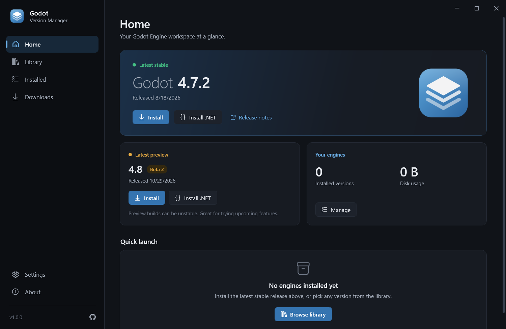
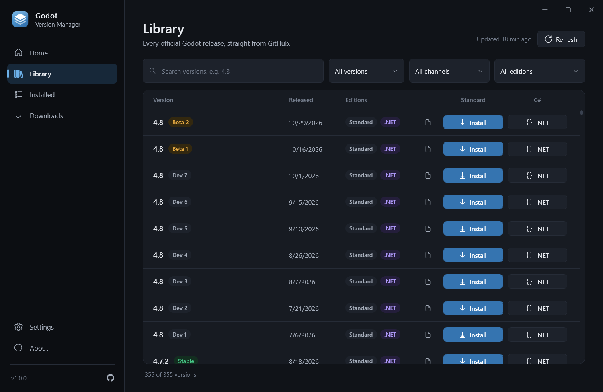
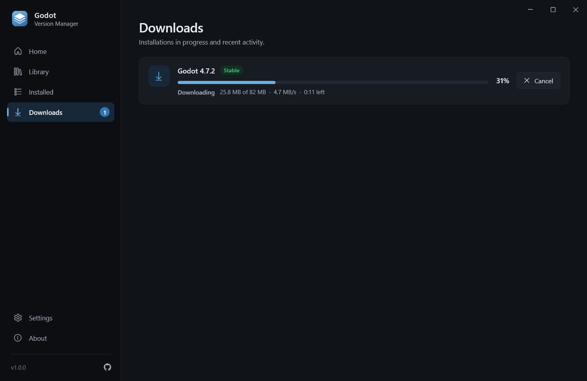
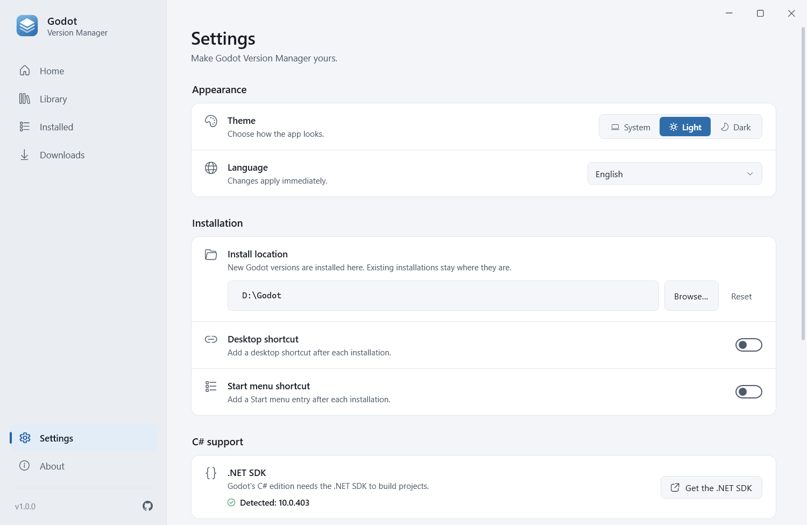
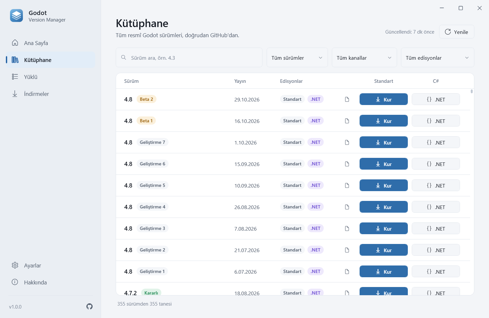

<div align="center">


# Godot Version Manager

**Install, manage and launch every Godot Engine version on Windows.**

[](https://github.com/yusuf-toktas/GodotVersionManager/actions/workflows/ci.yml)
[](https://github.com/yusuf-toktas/GodotVersionManager/releases/latest)
[](https://github.com/yusuf-toktas/GodotVersionManager/releases)
[](LICENSE)


[Download](#download) · [Features](#features) · [Usage](#usage) · [Build from source](#building-from-source) · [Türkçe](README.tr.md)



</div>

## Features

- **Every official release** — from Godot 2.x to the newest 4.x snapshot, read live from the official
  [godotengine/godot-builds](https://github.com/godotengine/godot-builds) repository. New versions show up automatically.
- **Standard and C# editions side by side** — install the .NET (Godot 4) or Mono (Godot 3) edition with one click.
  If the .NET SDK a C# edition needs is missing, the app tells you and links to it.
- **Fast, resilient downloads** — live progress, speed and time remaining; interrupted downloads resume where they
  stopped and stalled connections are retried automatically.
- **Safe by design** — HTTPS-only downloads from GitHub, SHA-256 verification whenever GitHub publishes a digest,
  protection against Zip Slip, path traversal and zip bombs, and atomic installs that never leave half-installed folders.
- **One place for your engines** — launch, open the folder, create a desktop shortcut or uninstall
  (together with the shortcuts the app created).
- **Works offline** — the release list is cached, so the library keeps working without a connection.
- **Polished interface** — dark and light themes (or follow Windows), live language switching, in-app notifications.
- **9 languages** — English, Türkçe, Deutsch, Español, Français, Português (Brasil), Русский, 简体中文, 日本語.
- **No admin rights, no clutter** — the app is a single executable and everything lives in your user profile.

## Screenshots

| Library | Downloads |
| :---: | :---: |
|  |  |
| **Settings (light theme)** | **Türkçe** |
|  |  |

## Download

Get the latest version from the **[Releases page](https://github.com/yusuf-toktas/GodotVersionManager/releases/latest)**:

| File | Description |
| --- | --- |
| `GodotVersionManager-<version>-win-x64-Setup.exe` | **Recommended.** Installer with a Start menu entry, optional desktop icon and clean uninstall. No administrator rights required. |
| `GodotVersionManager-<version>-win-x64.exe` | Standalone executable. Nothing to install — just run it. |
| `SHA256SUMS.txt` | Checksums to verify your download. |

**Requirements:** Windows 10 or 11, x64 (Windows 11 on ARM works through emulation). Nothing else is needed — the
.NET runtime is built in.

> [!NOTE]
> The executables are not code-signed yet, so Windows SmartScreen may say *"Windows protected your PC"* the first time.
> Choose **More info → Run anyway**. To verify a file, compare `Get-FileHash <file> -Algorithm SHA256` with
> `SHA256SUMS.txt`.

## Usage

1. **Home** shows the latest stable and preview builds. Click **Install** for the standard edition or
   **Install .NET** for C#.
2. **Library** lists every release. Search, filter by major version, channel or edition, and install any of them.
   The document icon opens the release notes on GitHub.
3. **Downloads** follows running installations — cancel or retry them there.
4. **Installed** lets you launch a version, open its folder, create a desktop shortcut or uninstall it.
5. **Settings** controls the theme, language, install location, shortcuts, update check and cache.

### Where are files stored?

| What | Location |
| --- | --- |
| Godot engines (default) | `%LOCALAPPDATA%\GodotVersionManager\Engines` — change it in **Settings → Install location** |
| Settings, cache and logs | `%LOCALAPPDATA%\GodotVersionManager` |

**Portable mode:** place an empty file named `portable.txt` next to `GodotVersionManager.exe`. All data — including
the default engines folder — is then kept in a `GodotVersionManagerData` folder beside the executable.

When you uninstall the app, the installer asks whether to remove this data as well (the answer defaults to *No*).

### GitHub rate limit

The release list comes from a few anonymous GitHub API requests and is cached for an hour. On a busy shared network
you might hit GitHub's limit of 60 requests per hour; the app then keeps showing the saved list. To raise the limit,
set the environment variable `GVM_GITHUB_TOKEN` to a GitHub personal access token (no scopes needed). The token is only
ever sent to `api.github.com`.

## Building from source

Requirements: Windows 10/11, the [.NET 10 SDK](https://dotnet.microsoft.com/download/dotnet/10.0) and — only for the
installer — [Inno Setup 6.6+](https://jrsoftware.org/isinfo.php) (`winget install JRSoftware.InnoSetup`).

```powershell
git clone https://github.com/yusuf-toktas/GodotVersionManager.git
cd GodotVersionManager

dotnet run --project src/GodotVersionManager.App   # run the app
dotnet test                                         # run the tests
./build/build.ps1                                   # release build -> artifacts/release
```

`build/build.ps1` runs the tests, publishes the self-contained single-file executable, builds the installer and writes
`SHA256SUMS.txt`. Options: `-Version 1.2.0`, `-SkipTests`, `-SkipInstaller`.

Pushing a tag such as `v1.0.0` runs the [release workflow](.github/workflows/release.yml), which builds both files and
publishes a GitHub release.

### Project structure

```text
src/
  GodotVersionManager.Core             Domain models, interfaces, version parsing, artifact resolution
  GodotVersionManager.Infrastructure   GitHub catalog, downloads, safe extraction, installation, storage
  GodotVersionManager.App              WPF app: views, view models, themes, localization
tests/                                 Unit tests, app tests and opt-in live integration tests
installer/InnoSetup/                   Installer script and artwork
build/                                 build.ps1 and the brand asset generator
docs/                                  Architecture notes and images
```

More details: [docs/architecture.md](docs/architecture.md).

## Translations

UI text lives in [`src/GodotVersionManager.App/Localization/Languages`](src/GodotVersionManager.App/Localization/Languages),
one JSON file per language. To add a language, copy `en.json` (for example to `it.json`), translate the values and open
a pull request — new files are picked up automatically, and the tests make sure every key and `{0}` placeholder is
present. See [CONTRIBUTING.md](CONTRIBUTING.md#translations).

## Contributing

Bug reports, ideas and pull requests are welcome — please read [CONTRIBUTING.md](CONTRIBUTING.md) first.
Security issues should be reported privately, as described in [SECURITY.md](SECURITY.md).

## Disclaimer

Godot Version Manager is an independent community project. It is **not** affiliated with, endorsed by or sponsored by
the Godot Foundation. "Godot" and the Godot logo are trademarks of the Godot Foundation. All engine builds are
downloaded from the official [godotengine/godot-builds](https://github.com/godotengine/godot-builds) repository.

## License

[MIT](LICENSE) © 2025–2026 Yusuf Toktaş
