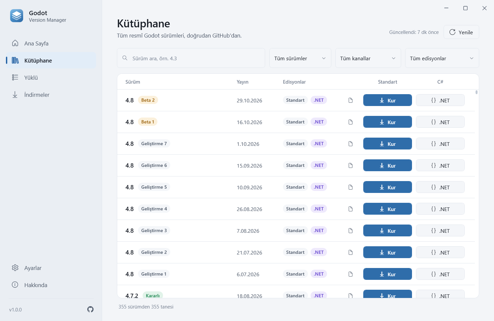
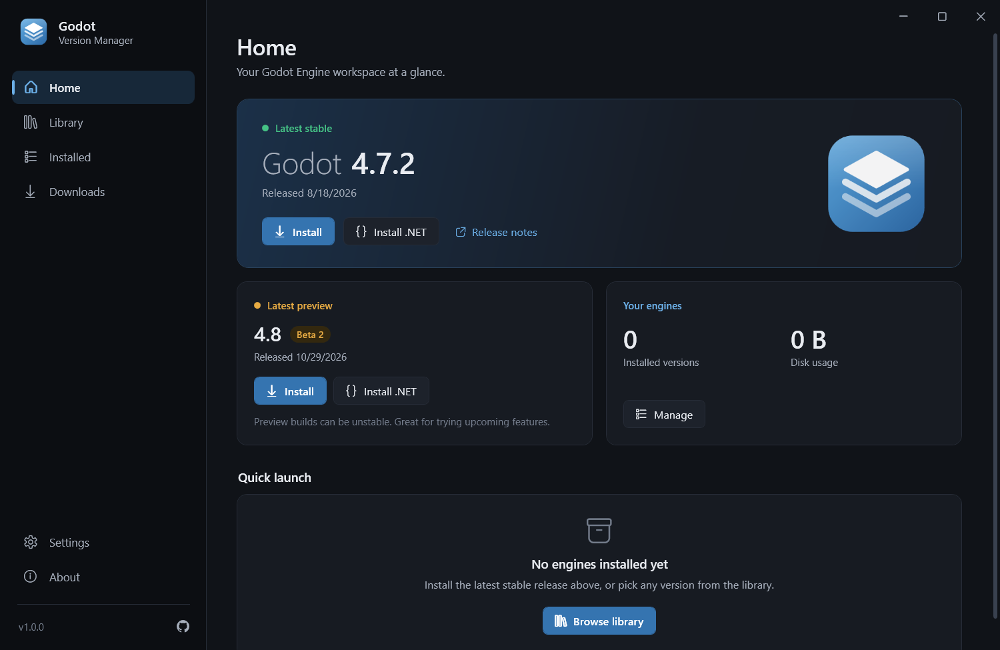
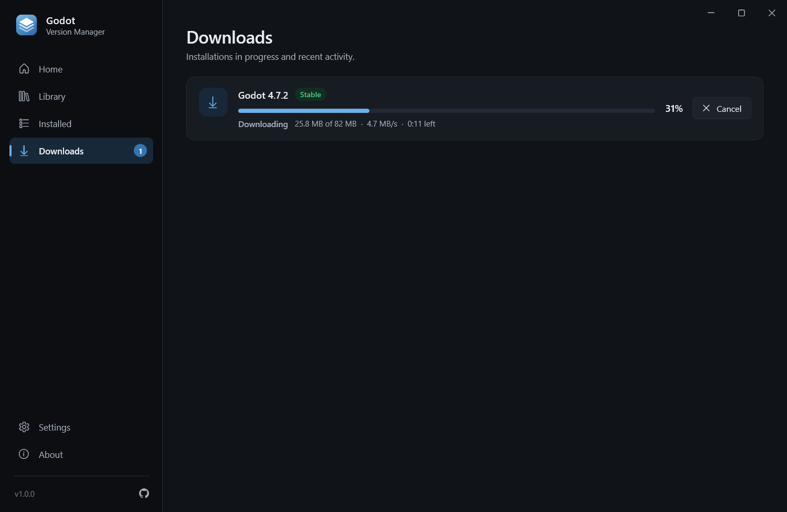
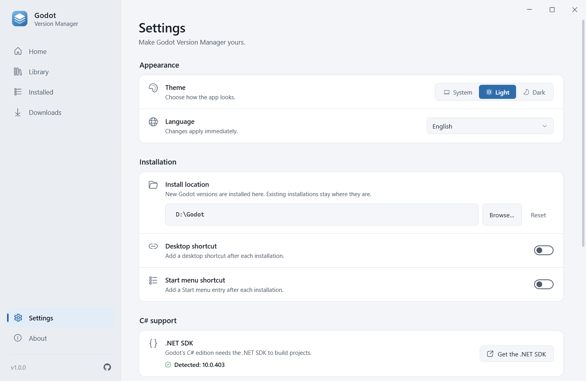
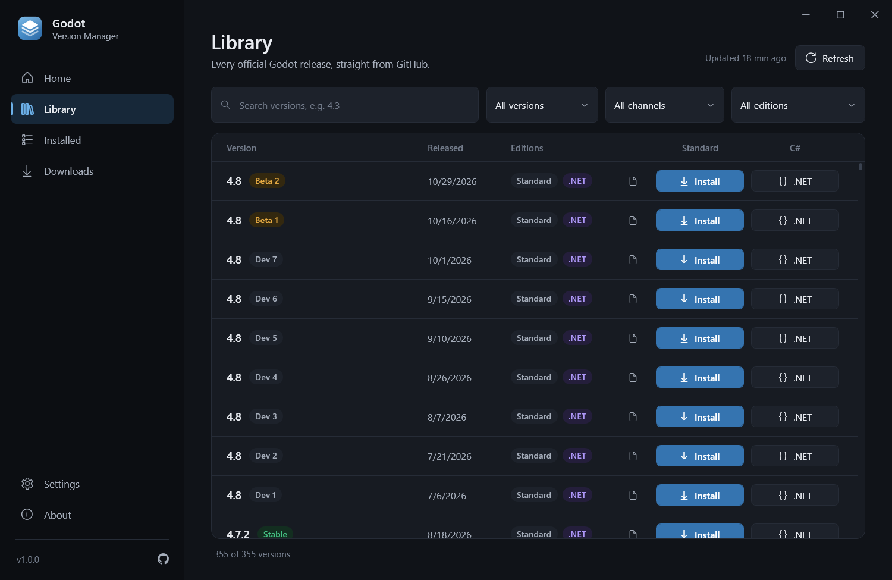

<div align="center">


# Godot Version Manager

**Windows'ta tüm Godot Engine sürümlerini kurun, yönetin ve başlatın.**

[](https://github.com/yusuf-toktas/GodotVersionManager/actions/workflows/ci.yml)
[](https://github.com/yusuf-toktas/GodotVersionManager/releases/latest)
[](https://github.com/yusuf-toktas/GodotVersionManager/releases)
[](LICENSE)


[İndir](#indirme) · [Özellikler](#özellikler) · [Kullanım](#kullanım) · [Kaynaktan derleme](#kaynak-koddan-derleme) · [English](README.md)



</div>

## Özellikler

- **Tüm resmî sürümler** — Godot 2.x'ten en yeni 4.x geliştirme sürümüne kadar her şey, resmî
  [godotengine/godot-builds](https://github.com/godotengine/godot-builds) deposundan canlı olarak okunur. Yeni sürümler
  kendiliğinden listelenir.
- **Standart ve C# edisyonları yan yana** — .NET (Godot 4) ya da Mono (Godot 3) edisyonunu tek tıkla kurun. C#
  edisyonunun ihtiyaç duyduğu .NET SDK eksikse uygulama bunu bildirir ve indirme bağlantısını gösterir.
- **Hızlı ve dayanıklı indirmeler** — canlı ilerleme, hız ve kalan süre; yarıda kalan indirmeler kaldığı yerden devam
  eder, takılan bağlantılar otomatik olarak yeniden denenir.
- **Güvenli tasarım** — yalnızca GitHub'dan HTTPS ile indirme, GitHub özet (digest) yayımladığında SHA-256 doğrulaması,
  Zip Slip / dizin aşımı / zip bombası koruması ve asla yarım klasör bırakmayan atomik kurulum.
- **Motorlarınız tek yerde** — başlatın, klasörünü açın, masaüstü kısayolu oluşturun ya da (uygulamanın oluşturduğu
  kısayollarla birlikte) kaldırın.
- **Çevrimdışı çalışır** — sürüm listesi önbelleğe alınır; bağlantı yokken de kütüphane kullanılabilir.
- **Rafine arayüz** — koyu ve açık tema (ya da Windows'u takip et), anında dil değiştirme, uygulama içi bildirimler.
- **9 dil** — English, Türkçe, Deutsch, Español, Français, Português (Brasil), Русский, 简体中文, 日本語.
- **Yönetici izni yok, dağınıklık yok** — uygulama tek bir exe dosyasıdır; her şey kullanıcı profilinizde tutulur.

## Ekran görüntüleri

| Ana Sayfa | İndirmeler |
| :---: | :---: |
|  |  |
| **Ayarlar (açık tema)** | **Kütüphane** |
|  |  |

## İndirme

En son sürümü **[Releases sayfasından](https://github.com/yusuf-toktas/GodotVersionManager/releases/latest)** indirin:

| Dosya | Açıklama |
| --- | --- |
| `GodotVersionManager-<sürüm>-win-x64-Setup.exe` | **Önerilen.** Başlat menüsü kaydı, isteğe bağlı masaüstü simgesi ve temiz kaldırma sunan kurulum. Yönetici izni gerekmez. |
| `GodotVersionManager-<sürüm>-win-x64.exe` | Tek başına çalışan exe. Kurulum gerekmez — çalıştırmanız yeterli. |
| `SHA256SUMS.txt` | İndirdiğiniz dosyaları doğrulamak için sağlama değerleri. |

**Gereksinimler:** Windows 10 veya 11, x64 (ARM'li Windows 11'de emülasyonla çalışır). Başka hiçbir şey gerekmez —
.NET çalışma zamanı uygulamanın içindedir.

> [!NOTE]
> Dosyalar henüz kod imzalı değildir; bu yüzden Windows SmartScreen ilk açılışta *"Windows bilgisayarınızı korudu"*
> uyarısı gösterebilir. **Ek bilgi → Yine de çalıştır** seçeneğini kullanın. Bir dosyayı doğrulamak için
> `Get-FileHash <dosya> -Algorithm SHA256` çıktısını `SHA256SUMS.txt` ile karşılaştırın.

## Kullanım

1. **Ana Sayfa** en son kararlı ve önizleme sürümlerini gösterir. Standart edisyon için **Kur**, C# için **.NET kur**
   düğmesine tıklayın.
2. **Kütüphane** tüm sürümleri listeler. Arayın; ana sürüme, kanala veya edisyona göre filtreleyin ve istediğinizi kurun.
   Belge simgesi GitHub'daki sürüm notlarını açar.
3. **İndirmeler** süren kurulumları izler — buradan iptal edebilir veya yeniden deneyebilirsiniz.
4. **Yüklü** sayfasından bir sürümü başlatabilir, klasörünü açabilir, masaüstü kısayolu oluşturabilir ya da
   kaldırabilirsiniz.
5. **Ayarlar** tema, dil, kurulum konumu, kısayollar, güncelleme denetimi ve önbelleği yönetir.

### Dosyalar nerede tutulur?

| Ne | Konum |
| --- | --- |
| Godot motorları (varsayılan) | `%LOCALAPPDATA%\GodotVersionManager\Engines` — **Ayarlar → Kurulum konumu** ile değiştirilebilir |
| Ayarlar, önbellek ve günlükler | `%LOCALAPPDATA%\GodotVersionManager` |

**Taşınabilir mod:** `GodotVersionManager.exe` dosyasının yanına `portable.txt` adında boş bir dosya koyun. Tüm veriler
— varsayılan motor klasörü dahil — exe'nin yanındaki `GodotVersionManagerData` klasöründe tutulur.

Uygulamayı kaldırırken kurulum programı bu verilerin de silinip silinmeyeceğini sorar (varsayılan yanıt *Hayır*).

### GitHub istek sınırı

Sürüm listesi birkaç anonim GitHub API isteğiyle alınır ve bir saat önbellekte tutulur. Kalabalık ortak bir ağda
GitHub'ın saatlik 60 istek sınırına takılabilirsiniz; bu durumda uygulama kayıtlı listeyi göstermeye devam eder. Sınırı
yükseltmek için `GVM_GITHUB_TOKEN` ortam değişkenine bir GitHub kişisel erişim belirteci (herhangi bir izin gerekmez)
atayın. Belirteç yalnızca `api.github.com` adresine gönderilir.

## Kaynak koddan derleme

Gereksinimler: Windows 10/11, [.NET 10 SDK](https://dotnet.microsoft.com/download/dotnet/10.0) ve — yalnızca kurulum
dosyası için — [Inno Setup 6.6+](https://jrsoftware.org/isinfo.php) (`winget install JRSoftware.InnoSetup`).

```powershell
git clone https://github.com/yusuf-toktas/GodotVersionManager.git
cd GodotVersionManager

dotnet run --project src/GodotVersionManager.App   # uygulamayı çalıştır
dotnet test                                         # testleri çalıştır
./build/build.ps1                                   # yayın derlemesi -> artifacts/release
```

`build/build.ps1` testleri çalıştırır, bağımsız ve tek dosyalık exe'yi yayımlar, kurulum dosyasını oluşturur ve
`SHA256SUMS.txt` yazar. Seçenekler: `-Version 1.2.0`, `-SkipTests`, `-SkipInstaller`.

`v1.0.0` gibi bir etiket gönderildiğinde [release iş akışı](.github/workflows/release.yml) iki dosyayı da derler ve bir
GitHub sürümü yayımlar.

### Proje yapısı

```text
src/
  GodotVersionManager.Core             Alan modelleri, arayüzler, sürüm ayrıştırma, paket seçimi
  GodotVersionManager.Infrastructure   GitHub kataloğu, indirme, güvenli arşiv açma, kurulum, depolama
  GodotVersionManager.App              WPF uygulaması: görünümler, view model'ler, temalar, yerelleştirme
tests/                                 Birim testleri, uygulama testleri ve isteğe bağlı canlı entegrasyon testleri
installer/InnoSetup/                   Kurulum betiği ve görselleri
build/                                 build.ps1 ve marka görseli üretici
docs/                                  Mimari notları ve görseller
```

Ayrıntılar: [docs/architecture.md](docs/architecture.md).

## Çeviriler

Arayüz metinleri her dil için bir JSON dosyası olarak
[`src/GodotVersionManager.App/Localization/Languages`](src/GodotVersionManager.App/Localization/Languages) klasöründedir.
Yeni bir dil eklemek için `en.json` dosyasını kopyalayın (örneğin `it.json`), değerleri çevirin ve bir pull request açın —
yeni dosyalar otomatik olarak tanınır; testler her anahtarın ve `{0}` yer tutucusunun bulunduğunu denetler. Ayrıntılar
için [CONTRIBUTING.md](CONTRIBUTING.md#translations).

## Katkıda bulunma

Hata bildirimleri, fikirler ve pull request'ler memnuniyetle karşılanır — lütfen önce [CONTRIBUTING.md](CONTRIBUTING.md)
dosyasını okuyun. Güvenlik açıklarını [SECURITY.md](SECURITY.md) dosyasında anlatıldığı gibi gizli olarak bildirin.

## Sorumluluk reddi

Godot Version Manager bağımsız bir topluluk projesidir. Godot Foundation ile **bağlantılı değildir**; Godot Foundation
tarafından onaylanmamış veya desteklenmemektedir. "Godot" ve Godot logosu Godot Foundation'ın ticari markalarıdır. Tüm
motor sürümleri resmî [godotengine/godot-builds](https://github.com/godotengine/godot-builds) deposundan indirilir.

## Lisans

[MIT](LICENSE) © 2025–2026 Yusuf Toktaş
